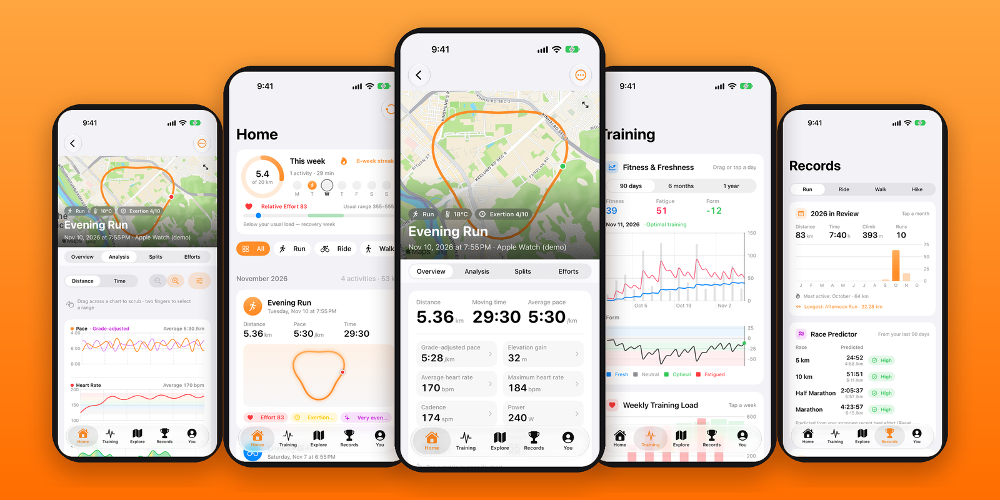
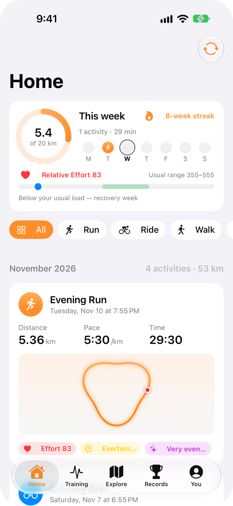
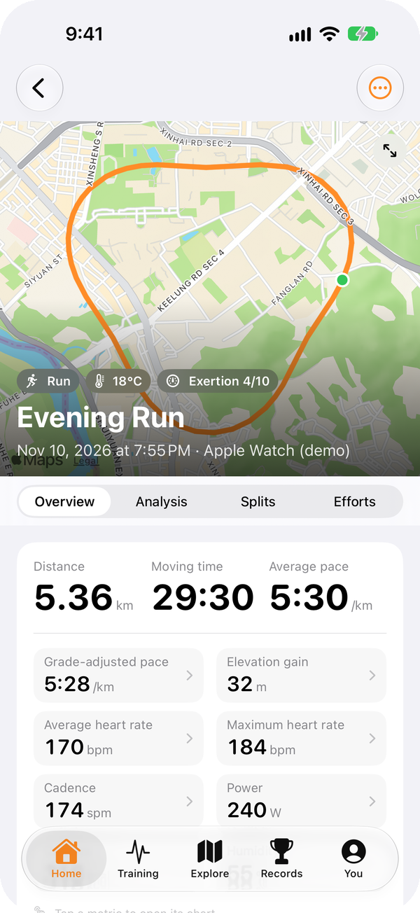
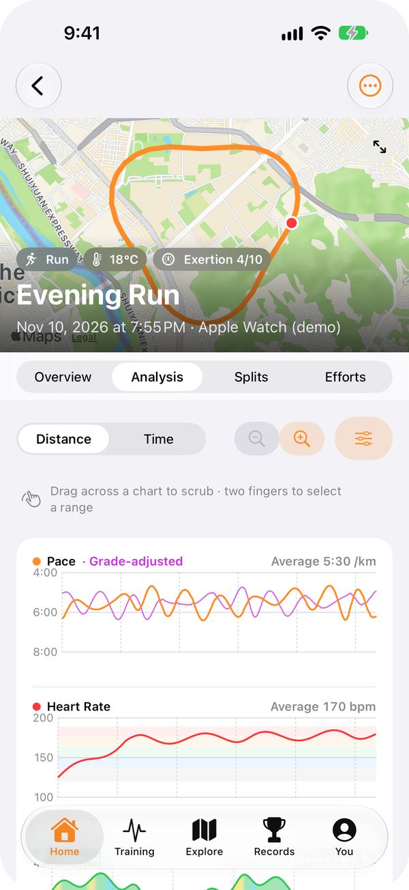
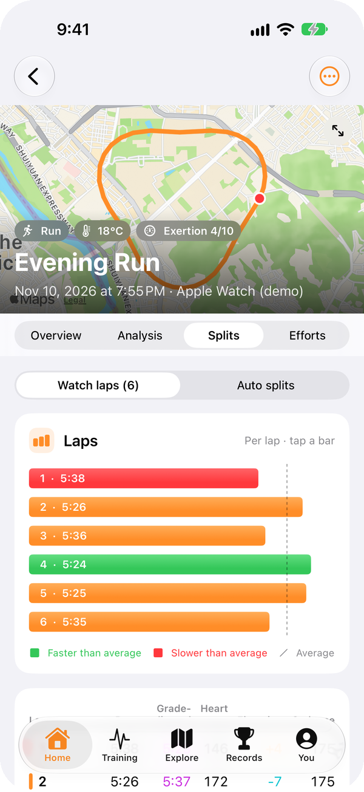
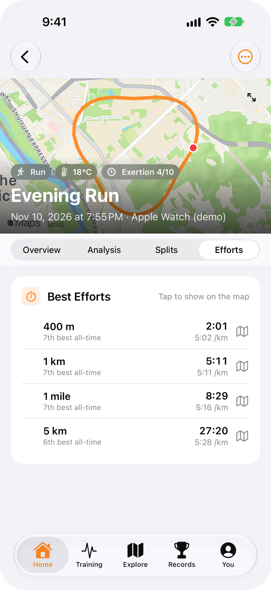
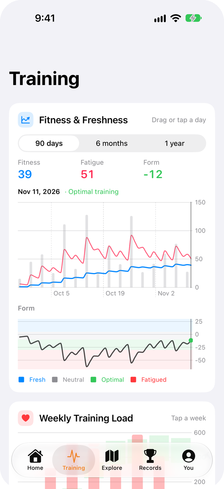
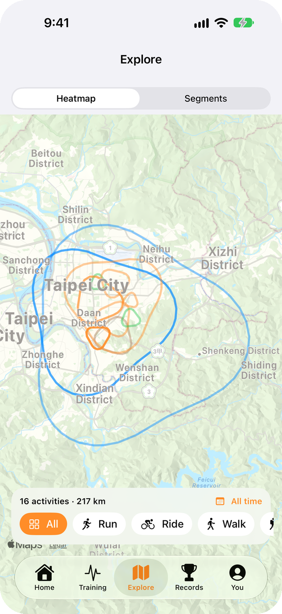
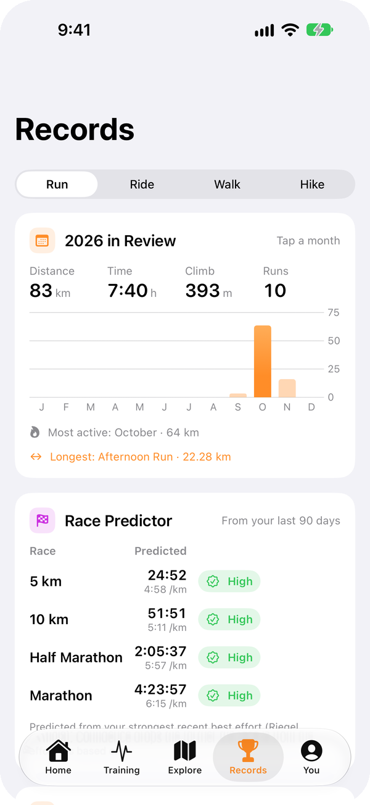
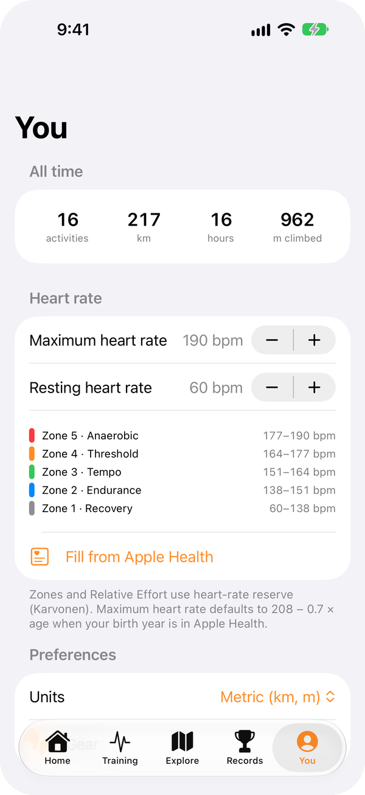

<div align="center">


# Stride

**Deep workout analysis for your Apple Health data. Private, and on your device.**

<p>
  
  
  
  
  
</p>



</div>

---

Stride turns the workouts already recorded by your Apple Watch into a detailed training log: grade-adjusted pace, heart-rate zones, aerobic decoupling, fitness & freshness, best efforts, segments, race predictions and more. No account, no server, no subscription — everything is read from Apple Health and computed on device.

## ✨ Highlights

- 📥 **Zero-effort import.** Workouts, GPS routes, heart rate, running dynamics, power, cadence, laps, pauses and weather, kept in sync through HealthKit background delivery.
- 📈 **Real analysis, not just totals.** Grade-adjusted pace (Minetti energy cost), Relative Effort (TRIMP), aerobic decoupling, moving vs. elapsed time and automatic insights.
- 🔗 **Linked charts and map.** Scrub any chart and the marker moves along the route. Pick a range with two fingers to get its stats or save it as a segment.
- 💪 **Training load over time.** Fitness, fatigue and form (CTL / ATL / TSB), weekly load against your usual range, trends and goals.
- 🏆 **Records that matter.** Best efforts with PR progression, a race predictor (Riegel + VDOT) and a year in review.
- 🔒 **Private by design.** Single user, on device. Nothing leaves your phone unless you export it.

## 📱 A tour of the app

### Home

<table>
  <tr>
    <td width="260" align="center"></td>
    <td>
      <p>Your week at a glance: a distance ring toward your weekly goal, an activity streak, and this week's <b>Relative Effort</b> compared with your usual range, with an instant read on whether you're building or recovering.</p>
      <p>Below that is the activity feed, grouped by month and filterable by sport. Each card shows the route, key stats and chips for effort, exertion and the top insight.</p>
    </td>
  </tr>
</table>

### Activity detail

Every workout opens on a full-bleed route map and four tabs that share one selection model, so a scrub, range or split you pick in one place shows up everywhere.

<table>
  <tr>
    <th width="25%">Overview</th>
    <th width="25%">Analysis</th>
    <th width="25%">Splits</th>
    <th width="25%">Efforts</th>
  </tr>
  <tr>
    <td width="25%" align="center"></td>
    <td width="25%" align="center"></td>
    <td width="25%" align="center"></td>
    <td width="25%" align="center"></td>
  </tr>
  <tr valign="top">
    <td>Moving vs. elapsed time, GAP, HR, cadence and power. Relative Effort with zone breakdown, automatic insights (negative split, pacing consistency, decoupling, route history, PRs), RPE, feel, gear and notes.</td>
    <td>Stacked lanes for pace + GAP, HR with zone bands, grade-coloured elevation, cadence and power. Distance or time axis, zoom and pan, comparison with a past run on the same route, and two-finger range stats.</td>
    <td>Watch laps or auto splits, colour-coded against your average. The table shows pace, GAP, HR, elevation and cadence. Tap a row to highlight it on the map, or jump straight to it in Analysis.</td>
    <td>Best efforts from 400 m to the marathon, ranked against your all-time bests, plus segment efforts. Tap one to show exactly where it happened on the route.</td>
  </tr>
</table>

### Training · Explore · Records · You

<table>
  <tr>
    <th width="25%">Training</th>
    <th width="25%">Explore</th>
    <th width="25%">Records</th>
    <th width="25%">You</th>
  </tr>
  <tr>
    <td width="25%" align="center"></td>
    <td width="25%" align="center"></td>
    <td width="25%" align="center"></td>
    <td width="25%" align="center"></td>
  </tr>
  <tr valign="top">
    <td><b>Fitness & Freshness</b> (CTL / ATL / TSB) over 90 days to a year, weekly load vs. usual range, a training calendar, trends (pace, HR, load, VO₂max, resting HR) with moving averages, and goals with projections.</td>
    <td>A personal <b>heatmap</b> of everywhere you've been, filterable by sport and date. <b>Personal segments</b> have leaderboards and effort history.</td>
    <td><b>Year in review</b>, a <b>race predictor</b> for 5K to marathon with confidence levels, and best efforts with PR progression and best-per-month charts.</td>
    <td>HR profile and Karvonen zones (auto-filled from Apple Health), km/mi units, gear mileage with replacement alerts, and CSV export (GPX per activity).</td>
  </tr>
</table>

## 🧠 The science inside

All of the analysis lives in **`StrideCore`**, a pure Swift package with unit tests that runs on macOS without a simulator.

| Metric | Method |
| --- | --- |
| Grade-adjusted pace | Minetti et al. metabolic cost of running on gradients |
| Relative Effort | Heart-rate TRIMP using heart-rate reserve (Karvonen) |
| Fitness / Fatigue / Form | Exponentially weighted CTL (42 d), ATL (7 d), TSB = CTL − ATL |
| Aerobic decoupling | Pace:HR drift, first half vs. second half |
| Race prediction | Riegel endurance model, cross-checked with VO₂max / VDOT |
| Segments & route history | Route signatures and segment matching on GPS tracks |
| Best efforts | Fastest rolling window for each standard distance |

## 🚀 Getting started

**Requirements:** Xcode with the iOS 17+ SDK and [XcodeGen](https://github.com/yonaskolb/XcodeGen) (`brew install xcodegen`).

```sh
git clone <this repo> && cd Stride
xcodegen generate          # project.yml → Stride.xcodeproj
open Stride.xcodeproj
```

1. In **Signing & Capabilities**, set your team (or fill in `DEVELOPMENT_TEAM` in `project.yml`). HealthKit and background delivery are already configured.
2. Run on a **real iPhone** to use your own Health data.
3. In the **Simulator**, tap **Try with demo data** during onboarding, or go to **You → Load demo data** (DEBUG builds).

### Debug launch arguments

DEBUG builds accept these arguments, which are handy for screenshots and UI work:

| Argument | Effect |
| --- | --- |
| `-demoData` | Seed demo activities and skip onboarding |
| `-tab training\|explore\|records\|you` | Start on a specific tab |
| `-openActivity N` | Push the Nth activity in the feed |
| `-detailTab overview\|analysis\|splits\|efforts` | Choose the activity tab to open |

```sh
xcrun simctl launch booted com.stanleyowen.stride -demoData -openActivity 1 -detailTab analysis
```

### Tests

```sh
cd StrideCore && swift test
```

## 🏗️ Architecture

```
Stride/
├── StrideCore/          Swift package: pure, Sendable analysis math + tests
│                        (route math, GAP, splits, training load, matching, race prediction, GPX)
├── Stride/
│   ├── Models/          Versioned SwiftData schema + migration plan
│   ├── Services/        HealthKit import, maintenance, records, export, demo data
│   ├── Views/           One folder per tab, plus Activity/ for the detail screen
│   └── DesignSystem/    DS tokens for spacing, colour and type
├── Branding/            Logo sources
└── project.yml          XcodeGen spec (targets, Info.plist, entitlements)
```

- **Import pipeline.** `HealthFetcher` queries HealthKit off the main thread and returns `Sendable` payloads with metrics already derived. `HealthImporter` writes them to SwiftData, enriches stale workouts and matches segments.
- **Persistence.** Versioned SwiftData schemas. Bulky series (route, HR, laps, efforts) are stored as JSON blobs and decoded lazily through a memoized cache.
- **Activity screen.** One shared `ActivityViewModel` drives all four tabs, so chart scrubbing, range selection and split highlights stay in sync with the map.

## 🔒 Privacy

Stride is a single-user app with no backend, analytics or third-party SDKs. It only **reads** from Apple Health, and deleting an activity in Stride never changes your Health data. Data leaves the device only when you choose to export it.

---

<div align="center">
  <sub>Built with SwiftUI, Swift Charts and a lot of easy miles. 🧡</sub>
</div>
